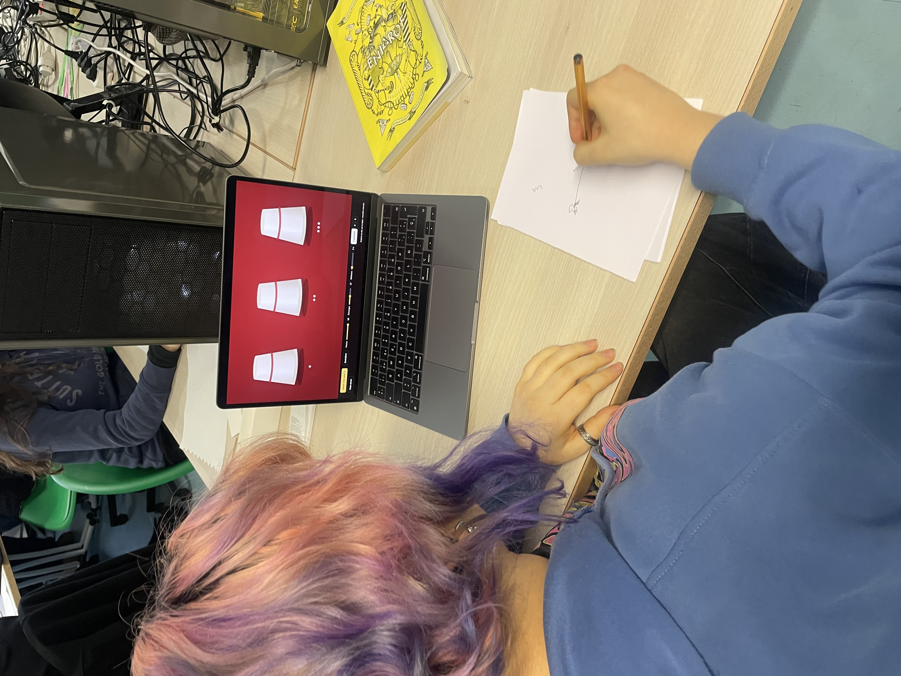
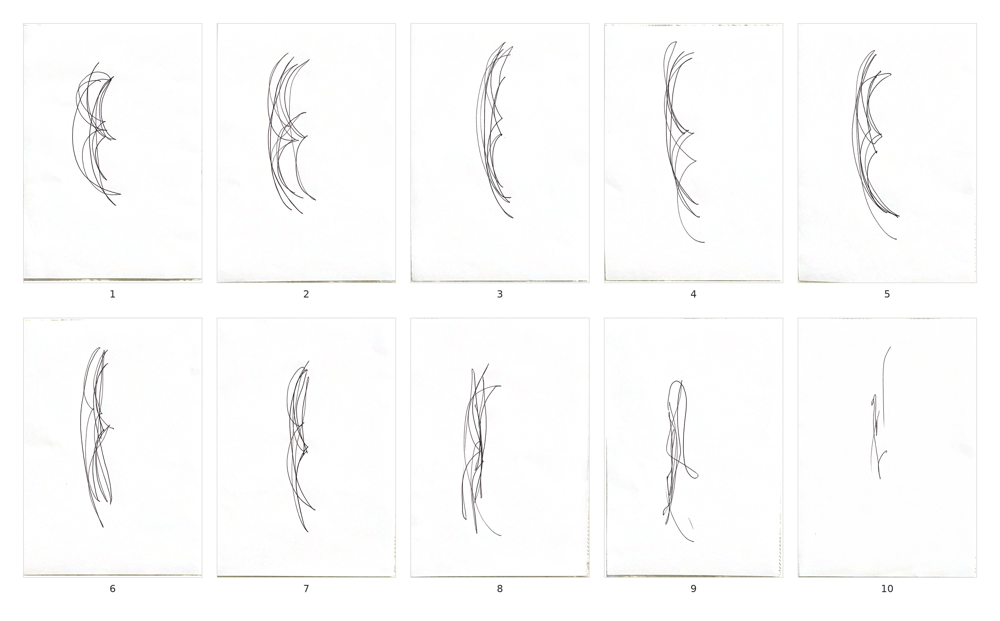
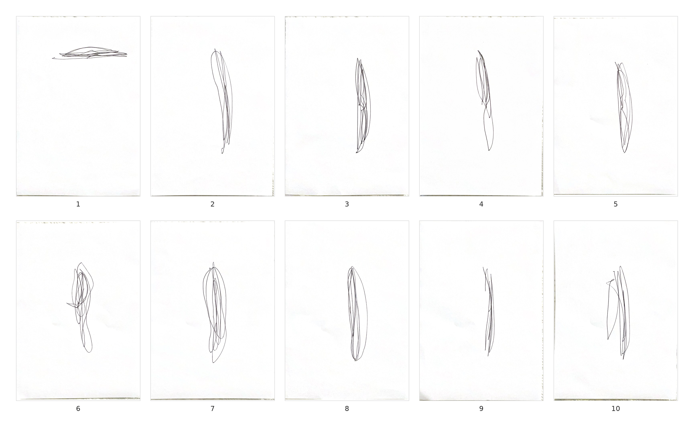
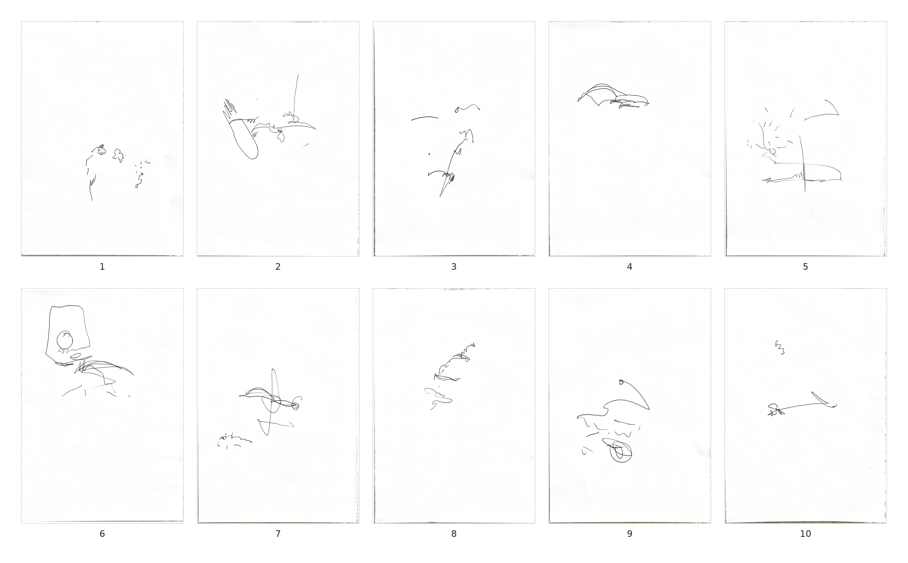

# Projet Nouvelles Narrations Numériques

## Gribouillis

### 23/11
-Def Gribouillis synonyme Sténographie Écriture asémique Gribouillage Graphe Griffonner 
CNRT

-Site qui récolte —> Cours Théorie des médias Étudiants machine Learning caché sous forme de jeu ?
Ex: Captcha, quick draw google
——> RECOLTE RADICALE 

système de récolte simple pour tous : ?  
sujet qu'est ce que je dis
data set interressant par la quantité gribouilli **pratique commune **

Lora 

Reconnaitre forme IA et écriture => faible 

On en fait quoi après ? 
Enjeux ? 

1. Objet que je récolte, trouver les définitions connu, et ma def
2. Qui en a parlé, ce qui existe et a été fait 
3. Récolter, journal de bord, annoter les récoltes jours dates…
4. Classification, reconnaissance ranger
5. On en fait quoi ?
Objet ? Machine à gribouiller ? 

ATTENTION : notion de code basique à incorporer 

Pour le moment ref qu’on m’a donné, élément que je dois consulter ou ref liées 
- Cours théorie des médias
- Vera Molnar Écriture 
- Claude Closky
- Evan Roth Graffiti 
- Neurones et intelligence simulées E+K
- An anthology of Asemic Handwriting Tim Gaze et Michael Jacobson
- Du gribouillis au dessin 
- Machine à dessiner Jean Tinguely 

Prendre position par rapport au ref comment elles ont impacté mon travail 

### 24/11/2026

**Ce que j'ai fait-->** Première récolte de gribouillis en classe. J'ai voulu mettre en place un dispositif simple me permettant de commencer rapidement à établir une base. Un·e camarade joue au bonneteau (jeu des gobeet /balle) pendant qu'il ou elle trace en continu sur une feuille, sans lever le stylo pendant 10 manches avec une difficulté croissante (vitesse). 

**Observations :** Le jeu influence fortement le trait les joueur·euse·s reproduisent le mouvement de la balle et des gobelets avec leur main. Le tracé est guidé par ce que l'œil suit et surtout comme aide pour trouver la balle. Je garde cette série comme un premier test

L'activité est trop présente visuellement, trop difficile et trop courte. Il faudrait une activité plus passive et plus longue qui occupe l'attention sans imposer un mouvement.

**Prochaine étape :** Tester d'autres activités 
Comparer les séries entre elles.

### 25/11/2026

En pensant que l'on a davantage tendance à gribouiller quand on a l'esprit ailleurs. Pendant qu'on écoute quelque chose notre main se balade toute seule sans objectif. Le cours m'est donc apparu comme un moment propice et en y réfléchissant je me suis rendue compte que j'avais déjà vu ce genre de traces sur les tables des salles de classe. J'aimerais donc récolter ce qui y est dessiné.
